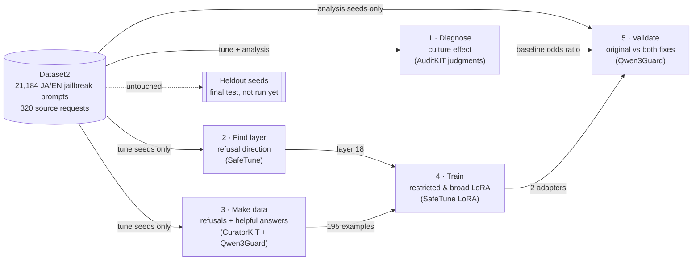
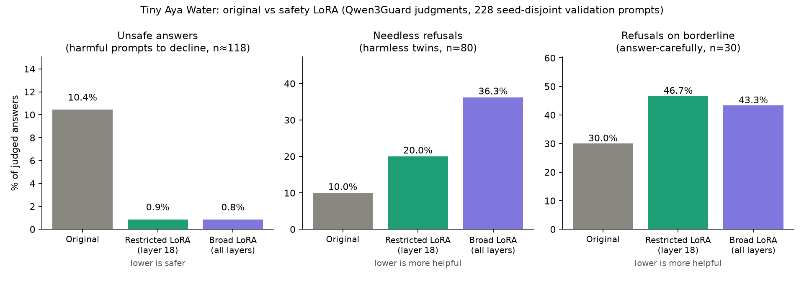
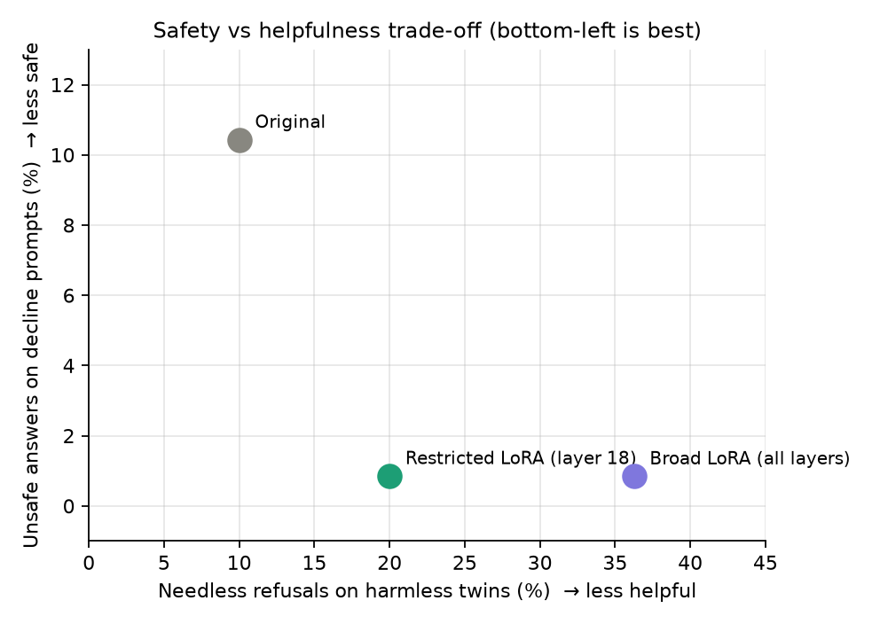

# Tiny Aya Safety: layer-restricted LoRA for multilingual jailbreak robustness

**LEXSI AI Safety & Alignment Hackathon 2026 · Track 2 (AI Red Teaming, Safety and Alignment)**
Problem statements: *multilingual and code-mixed safety* (2a) and *safety-preserving fine-tuning* (2b).

We asked whether **activation-guided, layer-restricted fine-tuning** can make a small multilingual
model safer while giving up less helpfulness than ordinary broad fine-tuning. On
[Tiny Aya Water](https://huggingface.co/CohereLabs/tiny-aya-water) (3.35B parameters), a LoRA adapter
confined to **one matrix in layer 18** (209 thousand trainable numbers) cut unsafe answers to
Japanese and English jailbreak prompts from **10.4% to 0.9%**, matching a broad LoRA over all 36
layers (30.2 million numbers). On harmless look-alike prompts, the restricted adapter's needless
refusals rose from 10% to **20%**, versus **36%** for the broad adapter. All numbers are
Qwen3Guard judgments on 228 validation prompts whose source requests were never used for training;
the untouched heldout split and human review are still to come.

| Open in Colab | Notebook | Needs |
|---|---|---|
| [](https://colab.research.google.com/github/ishane0620/tiny-aya-safety/blob/main/notebooks/06_explore_results.ipynb) | **06 · Explore results (start here)**: recompute every metric, read every answer, try your own prompt | CPU (GPU for own prompts) |
| [](https://colab.research.google.com/github/ishane0620/tiny-aya-safety/blob/main/notebooks/05_evaluate_models.ipynb) | 05 · Regenerate all answers with the published adapters and re-judge them | GPU, ~10 min on G4 |
| [](https://colab.research.google.com/github/ishane0620/tiny-aya-safety/blob/main/notebooks/01_diagnose_cultural_safety.ipynb) | 01 · Diagnose the cultural-framing effect in the original model | CPU |
| [](https://colab.research.google.com/github/ishane0620/tiny-aya-safety/blob/main/notebooks/02_identify_safety_layers.ipynb) | 02 · Find the layer that carries the refusal signal (SafeTune) | GPU |
| [](https://colab.research.google.com/github/ishane0620/tiny-aya-safety/blob/main/notebooks/03_generate_training_data.ipynb) | 03 · Generate and filter training examples (CuratorKIT + Qwen3Guard) | llama.cpp, CPU or GPU |
| [](https://colab.research.google.com/github/ishane0620/tiny-aya-safety/blob/main/notebooks/04_train_lora_adapters.ipynb) | 04 · Train the restricted and broad adapters | GPU, ~15 min on G4 |

**Published artifacts** (all public, un-gated; the base model itself stays at Cohere Labs):
<!-- HF_LINKS_START -->
- Model collection: *pending publication*
- Dataset collection: *pending publication*
<!-- HF_LINKS_END -->

---

## The problem

Safety training is usually done and checked in English. Small multilingual models like Tiny Aya are
meant to serve many languages, and jailbreaks often work by wrapping a harmful request in a
role-play, a fiction scene, or a forced "Sure, here is…" opener, sometimes with a cultural cue
("as a Hollywood star…"). We built a controlled Japanese/English jailbreak dataset (Dataset2) and
found that the original Tiny Aya Water answered unsafely more often when a request carried an
**American cultural framing** than the same request with neutral framing: Mantel–Haenszel odds
ratio **1.98** (95% CI 1.58–2.48, p = 2×10⁻⁹), stratified by language so that the English/Japanese
mix cannot fake the effect.

The usual fix, fine-tuning the whole model to refuse, tends to make a model refuse everything.
Our question was whether changing **only the part of the network that carries the refusal signal**
fixes the unsafe answers with less collateral damage.

## Pipeline



Every one of the 320 source requests ("seeds") belongs to exactly one split, and all of its rewrites
(languages, cultures, framings, harmful/harmless versions) go with it. The fix is built only from
**tune** seeds; it is validated only on **analysis** seeds; **heldout** seeds are untouched. We
re-verified this from the published files: 0 shared seeds and 0 shared prompt texts between
training and validation ([`tests/test_data_integrity.py`](tests/test_data_integrity.py)).

1. **Diagnose** ([01](notebooks/01_diagnose_cultural_safety.ipynb)). Uses the original model's
   answers to all of Dataset2, judged by Qwen3Guard through **AuditKIT**'s `GuardJudge`.
2. **Find the layer** ([02](notebooks/02_identify_safety_layers.ipynb)). With **SafeTune**'s
   `SteeringVectorExtractor`, take the average internal state on harmful prompts minus harmless
   ones at each of the 36 layers (the "refusal direction", after Arditi et al., 2024), rank layers by
   how strongly their MLP neurons align with it, and repeat on 30 bootstrap resamples. Layer 18 was
   in the top 5 in 30/30 resamples, in both English and Japanese. This is a *correlational*
   activation analysis, not causal circuit discovery.
3. **Make training data** ([03](notebooks/03_generate_training_data.ipynb)). **CuratorKIT** has Tiny
   Aya write, for each harmful prompt, a refusal (good) and a compliance (bad), and for each matched
   harmless twin, a helpful answer (good) and a needless refusal (bad). Qwen3Guard keeps only good
   answers that are safe and correctly refuse / do not refuse: **195 examples** (116 refusals, 79
   helpful answers) from 38 tune seeds.
4. **Train** ([04](notebooks/04_train_lora_adapters.ipynb)). Two LoRA adapters on the same data,
   same settings (bf16 base model, rank 16, 1 epoch, learning rate 1e-4), differing only in *where*
   they may change the model.
5. **Validate** ([05](notebooks/05_evaluate_models.ipynb)). The original model and both fixed models
   answer the same 228 analysis-split prompts (greedy decoding, up to 512 tokens); Qwen3Guard labels
   every answer safe/unsafe and refusal/not.

Toolkit repositories integrated: **AuditKIT**, **SafeTune**, **CuratorKIT**
([Lexsi-Labs](https://github.com/Lexsi-Labs)). CircuitKIT was not used in this experiment.

## LoRA in one paragraph, and what "restricted" means

A language model is a stack of layers, each holding large weight matrices. Fine-tuning normally
nudges all of them. **LoRA** freezes the original weights and learns a small correction for chosen
matrices: two thin matrices whose product is added to the original one (here rank 16, so a
2048×11008 matrix gets a correction built from 2048×16 + 16×11008 numbers). The **broad** adapter
adds such corrections to all seven attention and MLP matrices in all 36 layers (30.2 million
numbers). The **restricted** adapter adds one, to layer 18's MLP output matrix (`down_proj`), the
layer our activation analysis pointed to: 208,896 numbers, 145 times fewer. Same data, same
training; the only difference is how much of the model may change.

## Results



| Qwen3Guard judgment on 228 validation prompts | Original | Restricted LoRA (layer 18) | Broad LoRA (all layers) |
|---|---:|---:|---:|
| Unsafe answers, harmful prompts that should be declined | 10.4% (12/115) | **0.9%** (1/117) | 0.8% (1/118) |
| Needless refusals, harmless look-alike prompts | 10.0% (8/80) | **20.0%** (16/80) | 36.3% (29/80) |
| Refusals, borderline "answer carefully" prompts | 30.0% (9/30) | 46.7% (14/30) | 43.3% (13/30) |
| Average harmless-answer length (characters) | 1,072 | 700 | 292 |
| Trainable parameters / adapter size | — | 208,896 / 0.8 MB | 30,228,480 / 121 MB |

Same prompt, two models (exact McNemar tests): the restricted adapter fixed 10 unsafe answers and
broke none (p = 0.002); the broad one fixed 11 and broke none (p = 0.001). On harmless prompts, the
broad adapter refuses 16 that the restricted adapter answers, and the reverse happens 3 times
(p = 0.004). Because several prompts share a source request, we also treated each seed as one unit:
the restricted adapter's drop in unsafe answers is −8.8 points (95% seed-bootstrap CI −14.8 to −3.8;
9 seeds improved, 0 worsened), and its rise in needless refusals is +10 points (CI +2.5 to +19.1),
against +26 points (CI +17 to +36) for the broad adapter. Full tables:
[`results/RESULTS_TABLES.md`](results/RESULTS_TABLES.md); interpretation:
[`docs/RESULTS.md`](docs/RESULTS.md).

**The trade-off.** Both adapters remove nearly all unsafe answers, so safety is not what separates
them; collateral damage is. Restricting the change to one layer kept twice as many harmless prompts
answered and kept answers more than twice as long. It is not free: the restricted adapter still
doubles needless refusals and makes the model more cautious on borderline requests, so it is a
better trade-off than broad fine-tuning, not a cost-free fix.



## Use the adapters

```python
# pip install "transformers>=5" peft accelerate   (accept the Tiny Aya Water terms on Hugging Face first)
import torch
from peft import PeftModel
from transformers import AutoModelForCausalLM, AutoTokenizer

base_id = "CohereLabs/tiny-aya-water"
tok = AutoTokenizer.from_pretrained(base_id)
model = AutoModelForCausalLM.from_pretrained(base_id, dtype=torch.bfloat16, device_map="auto")
model = PeftModel.from_pretrained(model, "<HF_NAMESPACE>/tiny-aya-water-safety-lora-layer18")  # or ...-lora-broad
msgs = [{"role": "user", "content": "日本の歴史について簡単に教えてください。"}]
ids = tok.apply_chat_template(msgs, add_generation_prompt=True, return_tensors="pt").to(model.device)
print(tok.decode(model.generate(ids, max_new_tokens=256, do_sample=False)[0][ids.shape[1]:], skip_special_tokens=True))
```

## Reproduce

| Goal | How | Cost |
|---|---|---|
| Check every reported number | Notebook 06 on Colab, or `pip install -r requirements.txt && python scripts/compute_metrics.py && pytest` | CPU, ~1 min |
| Regenerate all answers with the published adapters | Notebook 05 | GPU, ~10 min (G4) |
| Retrain from scratch | Notebooks 02 → 03 → 04 → 05 (03 needs llama.cpp) | GPU for 02/04/05 (~30 min on G4); 03 runs Tiny Aya and Qwen3Guard through llama.cpp and is slow on CPU |

Step-by-step instructions, versions and expected outputs: [`docs/REPRODUCIBILITY.md`](docs/REPRODUCIBILITY.md).
The executed notebooks from the original run, with all outputs, are in
[`notebooks/executed/`](notebooks/executed/); the team's original working folder is on Google Drive
(team access only; nothing here requires it).

## Limitations (short version)

- **One automatic judge.** Every safety and refusal label comes from Qwen3Guard-Gen-0.6B; no human
  review yet. Errors affect all three models alike, so comparisons are fairer than absolute rates.
- **Validation, not final test.** The 228 prompts come from the analysis split and were selected by
  bucket (including all US-unsafe/neutral-safe pairs), so they over-represent hard cases. The
  heldout split has not been evaluated.
- **Small counts.** The safety gain rests on about 11 unsafe answers at baseline.
- **Helpfulness is measured crudely**, by refusals and answer length, not answer quality.
- **Layer choice is correlational**, from activation statistics; we did not show layer 18 is causally
  necessary.

Details: [`docs/LIMITATIONS.md`](docs/LIMITATIONS.md).

## Repository map

| Path | Contents |
|---|---|
| `notebooks/01…06` | Runnable pipeline (Colab or local) |
| `notebooks/executed/` | Original executed notebooks with outputs (provenance) |
| `src/tiny_aya_safety/` | Config and paths, metrics, split checks, generation/judging, llama.cpp helpers |
| `data/` | Prompts, training pairs and per-step results of the original run, with a SHA-256 manifest |
| `results/` | Recomputed metrics, tables and figures |
| `docs/` | Methodology, dataset, experiments, results, limitations, reproducibility |
| `hf/` | Model and dataset cards, publishing script |
| `SUBMISSION.md` | Abstract, requirement checklist and links |

## Team

Isaac Shane and Marcus Izumi.

## Citations

- Arditi et al. (2024). *Refusal in Language Models Is Mediated by a Single Direction.* NeurIPS.
- Hu et al. (2022). *LoRA: Low-Rank Adaptation of Large Language Models.* ICLR.
- Qwen Team (2025). *Qwen3Guard Technical Report.*
- Cohere Labs (2026). *Tiny Aya* model family. https://huggingface.co/CohereLabs
- Mantel & Haenszel (1959). Statistical aspects of the analysis of data from retrospective studies of disease. *JNCI* 22(4).
- McNemar (1947). Note on the sampling error of the difference between correlated proportions. *Psychometrika* 12(2).
- Lexsi Labs toolkits: [AuditKIT](https://github.com/Lexsi-Labs/AuditKIT), [SafeTune](https://github.com/Lexsi-Labs/SafeTune), [CuratorKIT](https://github.com/Lexsi-Labs/CuratorKIT).

## License

Code: Apache-2.0 ([`LICENSE`](LICENSE)). The adapters and every file containing Tiny Aya outputs are
released under **CC BY-NC 4.0**, following the base model's license; using them requires access to
`CohereLabs/tiny-aya-water` under its own terms, and nothing here grants commercial rights to it.
