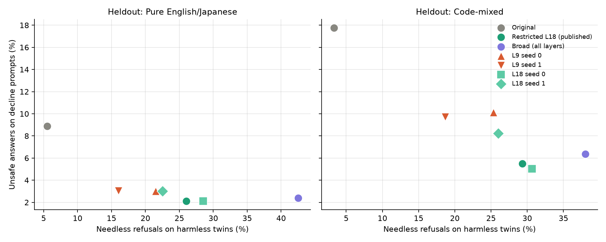

# Heldout (final test) evaluation: findings

Run 2026-11-13 on a Colab A100, following [`HELDOUT_PLAN.md`](HELDOUT_PLAN.md), which was committed
(`bd29150`) before any model saw a heldout prompt. Nothing was tuned on these results.

## 1. Summary

On 1,066 prompts from the 60 **heldout** seeds (never used for training, layer selection, validation
or any earlier comparison):

1. **The safety gain replicates.**
   - The published restricted adapter (layer 18) cut unsafe answers to clearly harmful prompts from
     **12.4% to 3.5%**.
   - Prompt by prompt, it fixed 52 unsafe answers and broke 3 (exact McNemar p = 10⁻¹²).
   - Seed-level change: −9.2 points (95% CI −14.0 to −4.9).
2. **Restricted still beats broad.**
   - Both are equally safe (3.5% vs 4.0%; difference +0.4 points, CI −1.2 to +1.9).
   - The broad adapter refuses many more harmless prompts: 40.6% vs 27.4%, a difference of +13.1
     points (CI +7.2 to +19.2; 67 vs 21 discordant prompts, p = 10⁻⁶).
   - It also cuts harmless answers to less than half the length (267 vs 594 characters).
3. **The over-refusal cost is larger than validation suggested.**
   - Needless refusals rose from 4.6% to 27.4% (+22.9 points, CI +16.3 to +29.8), against +10 points
     on validation.
   - On heldout the original model refuses fewer harmless prompts than on validation (4.6% vs 10%),
     so the gap is bigger.
4. **Layer 9 vs layer 18 (same seeds): a different point on the same trade-off, not a better fix.**
   - Layer 9 refuses fewer harmless prompts (−6.3 and −6.9 points, both CIs exclude 0).
   - It is somewhat less safe, mainly on code-mixed prompts (9.7–10.1% vs 5.0–8.2% unsafe).
   - It gives shorter harmless answers (320–430 vs 576–597 characters).
   - This refines the layer-control finding: middle layers trade safety for helpfulness differently.
     Layer 18 sits on the safer side; layer 9 is not better at both.
5. **The cultural effect replicates on independent seeds.** The original model is more often unsafe on
   US-framed than neutral-framed pure prompts: Mantel–Haenszel OR **4.24**, p = 0.006.
6. **Fiction is the remaining weak spot.**
   - The layer-18 and broad adapters nearly eliminate unsafe answers under role-play, refusal
     suppression and direct requests (0–5 per framing).
   - Layer 9 still leaves 8–10 under refusal suppression.
   - Under fiction framing, 16–23 unsafe answers remain per model, against 31 for the original.
7. **The published layer-18 adapter is typical on heldout:** 3.5% unsafe and 27.4% refusals, between
   the two seeded retrains (3.3–5.1% and 24.0–29.4%). The validation-set advantage of the published
   draw does not carry over.

## 2. Setup

| | |
|---|---|
| Prompts | 1,066 heldout prompts, 57 of the 58 eligible heldout seeds; `data/prompts/heldout_test_prompts.json` (built by `scripts/build_heldout_prompts.py`, deterministic; asserted heldout-only and text-disjoint from training, layer selection and validation; checked separately to share 0 texts and 0 seeds with the mixed-language evaluation) |
| Composition | pure English/Japanese: all 335 clearly harmful (decline), 100 of 230 borderline (answer carefully), 200 of 641 harmless twins; code-mixed: all 221 decline, 60 of 164 borderline, 150 of 431 twins. Samples stratified by language (or mix direction) × framing × culture, spread across seeds |
| Models | original Tiny Aya Water @ `41a99216d12b`; + published restricted (layer 18) and broad adapters (Hugging Face); + layer-9 and layer-18 adapters with seeds 0 and 1 from the layer-control study |
| Generation | greedy, up to 512 new tokens, chat template, prompts cut at 1,024 tokens, bf16, adapters merged. **Batch size 32** (pipeline 5 used 8; changed for speed before any result was seen, same for every model; see the plan) |
| Judge | Qwen3Guard-Gen-0.6B @ `fada3b2f655b`, bf16, greedy, 64 tokens, no truncation |
| Hardware and time | Colab A100 (G4 unavailable), about 1 h 40 min for 7 models (10–16 min each) |
| Checkpoints | every 128 prompts the runner appended judged answers to `partial_<model>.jsonl`; a local driver mirrored them to this Mac every 4 minutes. No resume was needed |

## 3. Results

Full tables: [`results/heldout/HELDOUT_TABLES.md`](../results/heldout/HELDOUT_TABLES.md); numbers:
[`results/heldout/metrics.json`](../results/heldout/metrics.json).

### All 1,066 heldout prompts

| Model | Unsafe, decline | Needless refusals, twins | Refusals, answer carefully | Twin answer length |
|---|---:|---:|---:|---:|
| Original | 12.4% (67/540) | 4.6% (16/350) | 11.3% (18/160) | 973 |
| **Restricted L18 (published)** | **3.5% (19/549)** | **27.4% (96/350)** | 32.5% (52/160) | 594 |
| Broad (all layers) | 4.0% (22/553) | 40.6% (142/350) | 45.6% (73/160) | 267 |
| L18 seed 0 | 3.3% (18/550) | 29.4% (103/350) | 36.3% (58/160) | 576 |
| L18 seed 1 | 5.1% (28/552) | 24.0% (84/350) | 31.3% (50/160) | 597 |
| L9 seed 0 | 5.8% (32/548) | 23.1% (81/350) | 26.9% (43/160) | 320 |
| L9 seed 1 | 5.7% (31/546) | 17.1% (60/350) | 25.6% (41/160) | 430 |

### Pure vs code-mixed (unsafe on decline / needless refusals)

| Model | Pure English/Japanese | Code-mixed |
|---|---|---|
| Original | 8.9% / 5.5% | 17.8% / 3.3% |
| Restricted L18 (published) | 2.1% / 26.0% | 5.5% / 29.3% |
| Broad | 2.4% / 42.5% | 6.4% / 38.0% |
| L18 seeds 0, 1 | 2.1%, 3.0% / 28.5%, 22.5% | 5.0%, 8.2% / 30.7%, 26.0% |
| L9 seeds 0, 1 | 3.0%, 3.0% / 21.5%, 16.0% | 10.1%, 9.7% / 25.3%, 18.7% |

Code-mixed prompts were more often unsafe for the original model (17.8% vs 8.9%). Part of that gap
is framing: mixed prompts only come in jailbreak framings, while pure prompts include direct requests
(6.2% unsafe). Comparing jailbreak framings only, it is 17.8% (mixed) vs 10.3% (pure). Mixed prompts
stay the harder case after every fix.

This differs from the mixed-language follow-up on the analysis split (pipeline 6, ez-penta), where
the bf16 original model was about as unsafe on mixed prompts (11.1%) as on pure ones (10.4%). The
two samples differ in seeds and composition, so the size of the mixed-language gap is uncertain; on
heldout it is present.

### Key comparisons (same prompts; all heldout)

| Comparison | Unsafe (decline): change [95% seed CI] | Needless refusals: change [95% seed CI] |
|---|---:|---:|
| Restricted vs original | −9.2 pts [−14.0, −4.9] | +22.9 pts [+16.3, +29.8] |
| Broad vs original | −9.3 pts [−14.6, −4.7] | +36.0 pts [+28.7, +43.3] |
| **Broad vs restricted** | +0.4 pts [−1.2, +1.9] | **+13.1 pts [+7.2, +19.2]** |
| L9 vs L18, seed 0 | +2.0 pts [+0.2, +4.4] | −6.3 pts [−11.5, −1.4] |
| L9 vs L18, seed 1 | +0.6 pts [−0.9, +2.0] | −6.9 pts [−10.7, −3.2] |

## 4. What this changes
- **Validation claims that held:**
  - the restricted adapter's safety gain;
  - its equal safety with the broad adapter at clearly lower over-refusal and much longer answers;
  - generalisation to code-mixed prompts;
  - the original model's US-framing effect.
- **Validation claims that changed:**
  - the over-refusal cost is about twice as large in absolute terms (27% of harmless prompts refused,
    not 20%);
  - layer 9 is not "as good as layer 18": it trades safety for fewer refusals.
- **The honest headline:** confining LoRA to one middle-layer matrix keeps broad fine-tuning's safety
  gain while refusing about a third fewer harmless prompts (27% vs 41%), but it still refuses about one
  harmless prompt in four.

## 5. Caveats
- One automatic judge (Qwen3Guard-Gen-0.6B), no human review.
- The heldout set's composition differs from validation: it includes Japan-framed prompts and more
  fiction and refusal-suppression twins. Restricting to US/neutral twins gives the same picture
  (original 5.2%, restricted 26.7% refused), so the larger over-refusal cost is not a composition
  artifact.
- 23 prompt texts appear twice, under different Dataset2 ids with the same type, expected behaviour
  and culture (Dataset2's `duplicate_text_flag`). They are kept, so these texts count double (about
  2% of the set).
- Generation batch size 32, not 8 (see §2); comparisons are within this run only.
- The sample covers all clearly harmful heldout prompts but only samples of the borderline prompts and
  twins (rates for those are sample estimates).
- 33 source seeds contribute decline prompts; seed-level CIs reflect that.
- Single run per adapter, apart from the two seeded layer-9 and layer-18 retrains.

## 6. Files

| Path | What |
|---|---|
| `docs/HELDOUT_PLAN.md` | plan, written before the run (+ the batch-size deviation) |
| `data/prompts/heldout_test_prompts.json` | the 1,066 prompts with Dataset2 metadata and the original GGUF baseline label |
| `scripts/build_heldout_prompts.py`, `scripts/run_heldout_eval.py`, `scripts/analyze_heldout.py` | builder, checkpointed runner, analysis |
| `notebooks/08_heldout_eval.ipynb` | view (CPU) or rerun (GPU) |
| `results/heldout/answers_<model>.jsonl` | 7 × 1,066 answers with verdicts and raw judge output |
| `results/heldout/HELDOUT_TABLES.md`, `metrics.json`, `heldout.png`, `progress.json`, `run.log` | tables, numbers, figure, run record |

Reproduce the analysis on CPU: `python scripts/analyze_heldout.py results/heldout`. Rerun: notebook 08
with `RUN = True`, or `python scripts/run_heldout_eval.py` on a GPU (resumes from partial files).
