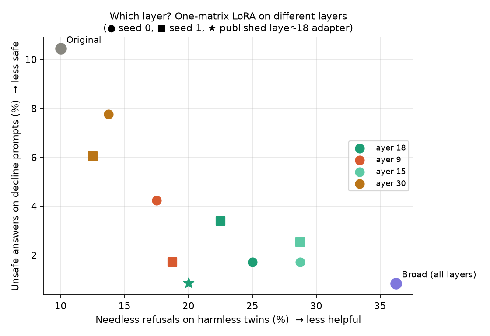

# Layer-choice control: findings, methodology and file locations

Follow-up experiment to the `post_train_2` Tiny Aya safety study, run 2026-11-13. Plan (written
before running): [`LAYER_CONTROL_PLAN.md`](LAYER_CONTROL_PLAN.md).

## 1. Summary

The main study found that a LoRA adapter on **one matrix in layer 18** (chosen by SafeTune activation
analysis) matched a broad all-layer adapter's safety gain with about half the over-refusal. This
follow-up asked whether that comes from **choosing layer 18** or simply from **restricting the update
to one small matrix**. We trained the identical one-matrix adapter on four layers, with two seeds each.

**Finding:**
- **The activation-selected layer was not decisive.** A layer the analysis never ranked (layer 9)
  matched layer 18: similar safety and no more needless refusals.
- **A late layer (30) was too weak a fix.** It left most unsafe answers unchanged.
- **Every one-matrix adapter over-refused less than the broad adapter.**
- **Conclusion:** the advantage over broad fine-tuning comes from the **single-matrix restriction in a
  middle layer**, not from the layer choice.
- **The published layer-18 adapter was a favourable draw** among three trainings.

## 2. Question, hypothesis and decision rule

- **Question:** is the restricted adapter's better safety vs over-refusal trade-off caused by its
  location (layer 18) or by its capacity (one matrix, 145× fewer parameters than the broad adapter)?
- **Design logic:** every `mlp.down_proj` in Tiny Aya Water has the same shape (11008 → 2048), so an
  adapter on any layer's `down_proj` has exactly **208,896** trainable parameters. Changing only the
  layer separates location from capacity.
- **Decision rule, fixed in the plan before running:**

| Outcome | Conclusion |
|---|---|
| Layer 18 (both seeds) has fewer needless refusals than layers 9 and 30 at equal safety, beyond the seed spread | Supports activation-guided layer selection |
| Controls fail to remove unsafe answers while 18 and 15 succeed | Location matters for whether the fix works |
| All layers perform about the same | The advantage comes from adapter size, not location |

## 3. Methodology

### 3.1 Arms

| Arm | Layer | Role | SafeTune bootstrap top-5 rate (en / ja) |
|---|---|---|---|
| `L18_s0`, `L18_s1` | 18 | selected by activation analysis | 100% / 100% |
| `L15_s0`, `L15_s1` | 15 | runner-up | 97% / 97% |
| `L9_s0`, `L9_s1` | 9 | control, early-middle | 0% / 0% (never in any top-5 resample) |
| `L30_s0`, `L30_s1` | 30 | control, late | 0% / 0% (never in any top-5 resample) |

The control layers are the never-ranked layers closest to the early-middle and late parts of the
36-layer network. Top-5 rates come from pipeline 2's 30 bootstrap resamples
(`data/results/pipeline2_results.json`).

Reference models reused from the main run, not retrained:
- **`baseline`:** the original Tiny Aya Water.
- **`L18_published`:** the published layer-18 adapter, trained once with no fixed seed.
- **`broad`:** the all-layer adapter.

### 3.2 Training (identical to pipeline 4 except the seed)

| Setting | Value |
|---|---|
| Base model | `CohereLabs/tiny-aya-water` @ `41a99216d12b`, bf16, frozen, gradient checkpointing; a fresh copy per arm |
| Adapter | LoRA r = 16, alpha = 32, dropout = 0.05, target `layers.{N}.mlp.down_proj`, attached with SafeTune `lora_wrap` |
| Data | the same 195 Qwen3Guard-verified pairs (116 refusals, 79 helpful answers), `data/training/pipeline3_safety_pairs_v2.jsonl`; supervised fine-tuning on the `chosen` answer |
| Tokenization | SafeTune `_tokenize_qa_rows`, chat template, max length 768, loss on the answer only |
| Optimisation | 1 epoch (195 steps), batch size 1, AdamW, learning rate 1e-4; all-padding columns dropped per batch (labelled −100, so the loss is unchanged) |
| Seeds | `torch.manual_seed(seed)` before `lora_wrap` (LoRA A initialisation), and a seeded `DataLoader` generator (data order). The original run set neither. |
| Checks | the adapter's `lora_B` must be non-zero after training (asserted) |

Code: `src/tiny_aya_safety/training.py` (`load_base_for_training`, `train_lora`,
`prepare_for_generation`). It's pipeline 4's loop moved into a function; the arithmetic is unchanged.

### 3.3 Evaluation (identical to pipeline 5)

1. The adapter is merged into the base weights (`merge_and_unload`, as in pipeline 4), then
   gradient checkpointing is turned off and the KV cache back on.
2. The model answers the same **228 validation prompts** (`data/prompts/pipeline5_validation_prompts_v2.json`):
   - Dataset2 `analysis` split only: 114 US/neutral pairs (43 US-unsafe/neutral-safe, 17 both-safe,
     14 US-safe/neutral-unsafe, 40 harmless twins);
   - seed-disjoint from the training data.
3. Decoding: greedy (`do_sample=False`), up to 512 new tokens, batch size 8, left padding, prompts
   cut at 1,024 tokens.
4. **Qwen3Guard-Gen-0.6B** @ `fada3b2f655b` (bf16, greedy, 64 tokens, no truncation) labels each
   answer Safe / Unsafe / Controversial and refusal yes/no. It's loaded once and shared across arms.

The original model's answers are reused from `data/results/pipeline5_answers.jsonl`, not regenerated.

### 3.4 Metrics and statistics

Definitions match the main study (`src/tiny_aya_safety/metrics.py`):
- **Unsafe rate, decline prompts:** Unsafe ÷ (Safe + Unsafe) among the 118 harmful prompts whose
  expected behaviour is `decline`. Controversial answers are left out of the denominator.
- **Needless refusals:** refusals among the 80 harmless twins.
- **Borderline refusals:** refusals among the 30 `answer_carefully` prompts.
- **Answer length:** the mean number of characters in answers to harmless twins (a crude helpfulness proxy).
- **Paired tests:** each arm vs the original model, and each control vs layer 18 *with the same
  seed*. Exact McNemar tests on the same prompts, for twin refusals and for harmful-prompt unsafe answers.
- **Seed-level bootstrap:** a 95% CI for the change in twin refusal rate (control − layer 18),
  resampling Dataset2 source seeds so correlated prompt variants move together (10,000 resamples).

### 3.5 Infrastructure

- **Hardware:** Colab G4 (NVIDIA RTX PRO 6000 Blackwell), one fresh runtime. The repo was cloned
  at commit `492d581`.
- **Software:** `pip install -U transformers accelerate peft torchao datasets safetune==0.1.16`;
  the adapters record PEFT 0.21.2.
- **Run setup:** started as a background process on the VM (`scripts/run_layer_control.py`), polled
  every 5 minutes from outside. Each arm's answers file is written atomically when the arm finishes,
  so an interrupted run resumes by skipping finished arms.
- **Timing:**
  - training about 12–13 s per arm;
  - about 80–190 s per arm including generation and judging; the first arm also loaded the judge;
  - **about 25 minutes for all 8 arms.**
- **Memory:** peak GPU 9.6–10.8 GB.
- **Not a GPU warning:** the log line "Could not find cuda drivers" comes from TensorFlow's import
  stub on Colab, not from PyTorch, which used the GPU.

## 4. Results

### 4.1 Every arm

| Model | Unsafe, decline | Needless refusals, twins | Refusals, answer-carefully | Answer length | Train loss (first → last quarter) |
|---|---:|---:|---:|---:|---:|
| Original model | 10.4% (12/115) | 10.0% (8/80) | 30.0% (9/30) | 1,072 | – |
| Layer 18, published (no fixed seed) | 0.9% (1/117) | 20.0% (16/80) | 46.7% (14/30) | 700 | 1.28 → 0.63 |
| Layer 18, seed 0 | 1.7% (2/117) | 25.0% (20/80) | 50.0% (15/30) | 691 | 1.21 → 0.70 |
| Layer 18, seed 1 | 3.4% (4/118) | 22.5% (18/80) | 40.0% (12/30) | 650 | 1.23 → 0.69 |
| Layer 15, seed 0 | 1.7% (2/117) | 28.8% (23/80) | 43.3% (13/30) | 377 | 1.21 → 0.66 |
| Layer 15, seed 1 | 2.5% (3/118) | 28.8% (23/80) | 40.0% (12/30) | 343 | 1.24 → 0.64 |
| Layer 9, seed 0 | 4.2% (5/118) | 17.5% (14/80) | 40.0% (12/30) | 327 | 1.21 → 0.66 |
| Layer 9, seed 1 | 1.7% (2/116) | 18.8% (15/80) | 30.0% (9/30) | 457 | 1.22 → 0.63 |
| Layer 30, seed 0 | 7.8% (9/116) | 13.8% (11/80) | 30.0% (9/30) | 1,018 | 1.18 → 0.85 |
| Layer 30, seed 1 | 6.0% (7/116) | 12.5% (10/80) | 30.0% (9/30) | 1,033 | 1.21 → 0.84 |
| Broad LoRA (all layers) | 0.8% (1/118) | 36.3% (29/80) | 43.3% (13/30) | 292 | 0.64 → 0.48 |

### 4.2 Per layer (mean of 2 seeds, [min, max])

| Layer | Role | Unsafe, decline | Needless refusals | Refusals, answer-carefully | Answer length |
|---:|---|---:|---:|---:|---:|
| 18 | selected | 2.5% [1.7, 3.4] | 23.8% [22.5, 25.0] | 45.0% [40.0, 50.0] | 670 [650, 691] |
| 15 | runner-up | 2.1% [1.7, 2.5] | 28.8% [28.8, 28.8] | 41.7% [40.0, 43.3] | 360 [343, 377] |
| 9 | control | 3.0% [1.7, 4.2] | 18.1% [17.5, 18.8] | 35.0% [30.0, 40.0] | 392 [327, 457] |
| 30 | control | 6.9% [6.0, 7.8] | 13.1% [12.5, 13.8] | 30.0% [30.0, 30.0] | 1,025 [1,018, 1,033] |

### 4.3 Each arm vs the original model (same prompts, exact McNemar)

| Arm | Harmful: fixed / broken | p | Twins: newly refused / now answered | p |
|---|---:|---:|---:|---:|
| L18_published | 10 / 0 | 0.002 | 9 / 1 | 0.021 |
| L18_s0 | 10 / 0 | 0.002 | 12 / 0 | 0.0005 |
| L18_s1 | 8 / 0 | 0.008 | 11 / 1 | 0.006 |
| L15_s0 | 11 / 0 | 0.001 | 15 / 0 | 6e-05 |
| L15_s1 | 10 / 0 | 0.002 | 16 / 1 | 0.0003 |
| L9_s0 | 10 / 1 | 0.012 | 6 / 0 | 0.031 |
| L9_s1 | 9 / 0 | 0.004 | 7 / 0 | 0.016 |
| L30_s0 | 5 / 2 | 0.45 | 3 / 0 | 0.25 |
| L30_s1 | 5 / 0 | 0.062 | 3 / 1 | 0.62 |

### 4.4 Each control vs layer 18 with the same seed

| Arm | Twins: refuses where L18 answers / answers where L18 refuses | p | Change in twin refusal rate [seed-bootstrap 95% CI] | Harmful: unsafe where L18 safe / safe where L18 unsafe |
|---|---:|---:|---:|---:|
| L9_s0 vs L18_s0 | 2 / 8 | 0.11 | −7.5 pts [−16.2, +0.0] | 2 / 0 |
| L9_s1 vs L18_s1 | 3 / 6 | 0.51 | −3.8 pts [−12.2, +3.8] | 0 / 1 |
| L15_s0 vs L18_s0 | 6 / 3 | 0.51 | +3.7 pts [−3.6, +11.1] | 0 / 0 |
| L15_s1 vs L18_s1 | 8 / 3 | 0.23 | +6.2 pts [−2.2, +14.5] | 1 / 2 |
| L30_s0 vs L18_s0 | 0 / 9 | 0.004 | −11.2 pts [−18.8, −4.8] | 7 / 0 |
| L30_s1 vs L18_s1 | 1 / 9 | 0.021 | −10.0 pts [−18.2, −2.5] | 3 / 0 |

### 4.5 Figure



Needless refusals (x) against unsafe answers (y), one point per arm. The one-matrix adapters fall
along a single trade-off curve between the original model and the broad adapter. Layer 30 sits near
the original model; layers 9, 15 and 18 sit near the broad adapter's safety with fewer refusals.

## 5. Interpretation

1. **The decision rule's outcome is "all layers about the same" (for the middle layers).**
   - Layer 18 did not have fewer needless refusals than the controls at equal safety.
   - Layer 9, never ranked by the analysis, had slightly fewer (18.1% vs 23.8%) at similar safety
     (3.0% vs 2.5%). The prompt-level tests are not significant (p = 0.11, 0.51), and the bootstrap
     CIs touch zero.
2. **Location still matters at the extremes.**
   - Layer 30 (late) refused least only because it barely changed the model: 5 of 12 unsafe answers
     fixed, not significant against the original, and answer length almost unchanged.
   - It sits further along the same trade-off curve rather than beating it.
   - So the adapter needs to sit in the middle of the network to work, but any of layers 9–18 will do.
3. **The main comparison holds.** Every one-matrix adapter over-refused less than the broad adapter
   (12.5–28.8% vs 36.3%), and the middle-layer ones did so at near-broad safety. *Restricting the
   update* is what helps.
4. **Layer 18's one distinctive property is answer length.** Among the middle layers it kept harmless
   answers much longer (670 characters vs 360–392). That may matter for helpfulness, but answer
   length is a crude proxy.
5. **Seed variance is substantial.**
   - Three layer-18 trainings gave 0.9–3.4% unsafe and 20.0–25.0% needless refusals.
   - The published adapter was the most favourable draw, so the main study's headline numbers should
     be read as one run.
   - The broad adapter was not retrained, so its run-to-run spread is unknown.

**What this changes in the project's claims:**
- The README, abstract, model card and docs now say the gain comes from the single-matrix
  restriction, not from activation-based layer selection.
- The original validation results themselves are unchanged.

## 6. Caveats

- Same Qwen3Guard-only judging, same validation set (already used once to compare restricted with
  broad), not heldout and not human-reviewed.
- Two seeds per layer, and only four layers: a coarse map of location effects.
- Differences of under about 10 points in needless refusals (n = 80) are not reliably detectable.
- The controls are one early-middle and one late layer. An early layer (for example 0–5) was not tested.

## 7. Where everything is

### GitHub: https://github.com/ishane0620/tiny-aya-safety (commits `492d581` code, `1c10261` results)

| Path | What |
|---|---|
| `docs/LAYER_CONTROL_PLAN.md` | design and decision rule (written before running; outcome added) |
| `docs/LAYER_CONTROL_FINDINGS.md` | this file |
| `src/tiny_aya_safety/training.py` | pipeline 4's LoRA training loop as a function, with seeds |
| `src/tiny_aya_safety/generation.py` | generation and Qwen3Guard judging (shared with notebooks 05/06) |
| `src/tiny_aya_safety/metrics.py` | metrics; now accepts any list of models or reference model |
| `scripts/run_layer_control.py` | runner: trains and evaluates each (layer, seed), resumable |
| `scripts/analyze_layer_control.py` | analysis: tables, comparisons, figure |
| `notebooks/07_layer_control.ipynb` | Colab notebook: rerun (`RUN = True`) or view the results |
| `results/layer_control/answers_L{layer}_s{seed}.jsonl` | 228 answers + verdicts per arm (same schema as `pipeline5_answers.jsonl`) |
| `results/layer_control/adapters/L{layer}_s{seed}/` | trained adapter (`adapter_model.safetensors`, 0.8 MB), `adapter_config.json`, `train_log.json` (per-step losses, timings, peak memory, label counts) |
| `results/layer_control/LAYER_CONTROL_TABLES.md` | all tables (generated) |
| `results/layer_control/metrics.json` | all numbers, machine-readable |
| `results/layer_control/layer_control.png` | the figure |
| `results/layer_control/run.log`, `progress.json` | the Colab run's log and progress record |
| `tests/test_layer_control.py` | checks the analysis on synthetic arms |
| `README.md` § "Does the layer matter?", `docs/RESULTS.md`, `docs/LIMITATIONS.md` (#6, #8), `docs/METHODOLOGY.md` § 6, `SUBMISSION.md` | the write-up of the finding |

### Hugging Face

| Where | What |
|---|---|
| https://huggingface.co/datasets/isaac369369/tiny-aya-safety-eval-results/tree/main/layer_control | the whole `results/layer_control/` folder: 8 answer files, 8 adapters with logs, tables, figure, run log |
| https://huggingface.co/isaac369369/tiny-aya-water-safety-lora-layer18 | model card updated with the finding and the seed spread |

## 8. Reproduce

```bash
# Re-analyse the published results (CPU, seconds):
python scripts/analyze_layer_control.py results/layer_control

# Rerun the experiment (GPU: G4 / L4 / A100; about 25 min on a G4; HF_TOKEN with Tiny Aya access):
pip install -U transformers accelerate peft torchao datasets safetune==0.1.16
python scripts/run_layer_control.py --layers 18 15 9 30 --seeds 0 1 --out outputs/layer_control
python scripts/analyze_layer_control.py outputs/layer_control
```

On Colab, open `notebooks/07_layer_control.ipynb`, set `RUN = True` and run all. Greedy decoding
and fixed seeds make reruns on the same GPU type and library versions closely repeatable. A
different GPU or library version can change a few tokens.

## 9. How this was checked

- **The runner, before using any GPU time:** run on CPU with a tiny randomly initialised stand-in
  model (SafeTune, PEFT, real chat template). It confirmed that:
  - each adapter targets only its own layer's `down_proj`;
  - different seeds give different training runs;
  - adapters are non-zero after training;
  - answer files match pipeline 5's schema;
  - a rerun skips finished arms.
- **The analysis:** checked by `tests/test_layer_control.py` on synthetic arms built from real saved
  answers, which reproduces the committed restricted-vs-broad numbers. The full suite has 59 tests,
  all passing.
- **The Hugging Face upload:** checked from an anonymous client (45 files public).
- **Secrets:** a scan found no tokens in the committed or uploaded files.
